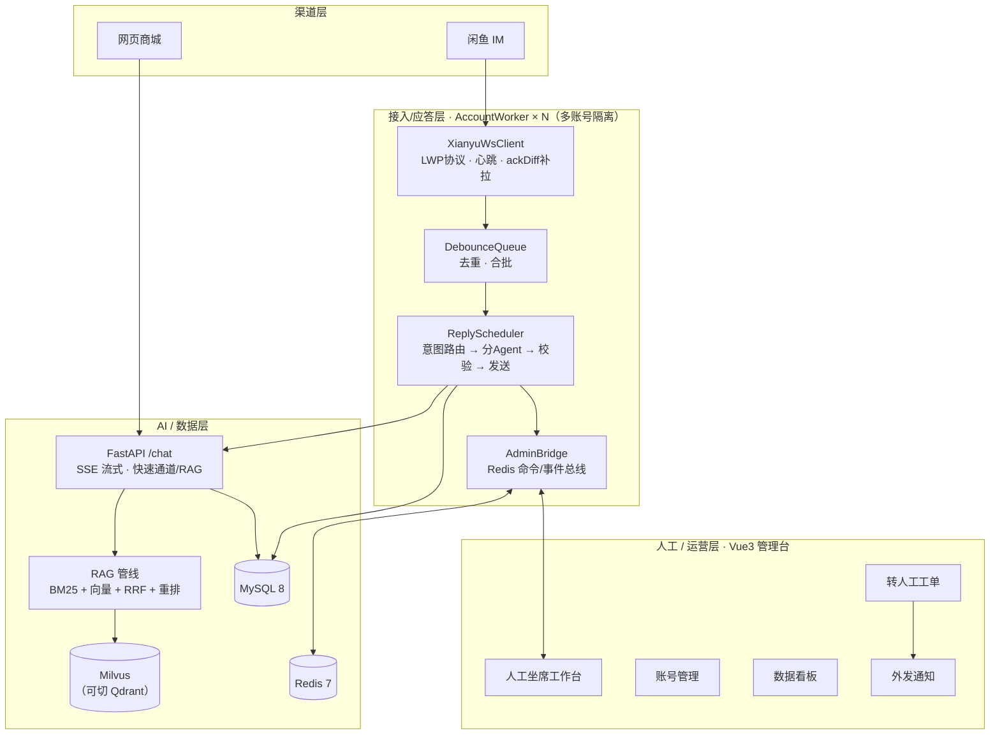
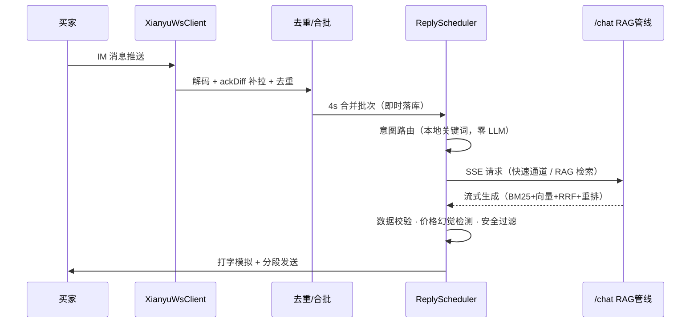
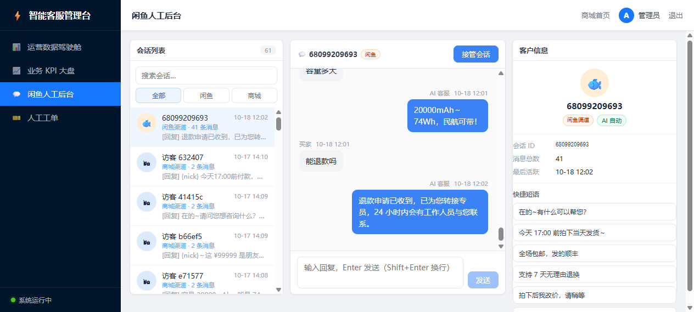
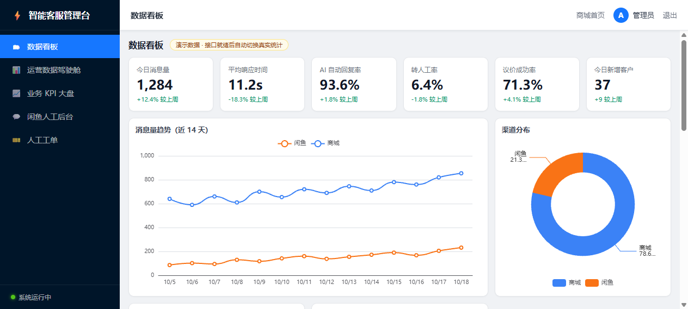

# 智能客服中台（电商全渠道 AI 客服系统）

> 多渠道接入 · AI 应答管线 · 人工坐席工作台 · 数据中台 —— 企业级 AI 客服中台

[](https://github.com/wu9506040-lab/e-commerce-customer-service/actions/workflows/ci.yml)
[](https://github.com/wu9506040-lab/e-commerce-customer-service/releases)
[](https://fastapi.tiangolo.com)
[](https://vuejs.org)
[](https://python.org)
[](https://typescriptlang.org)
[](https://milvus.io)
[](https://mysql.com)
[](https://redis.io)
[](https://docker.com)
[](LICENSE)

---

## 💡 项目定位

**企业级 AI 客服中台**：不是"闲鱼自动回复脚本"，而是完整覆盖 **多渠道接入 → AI 应答管线 → 人工坐席协同 → 数据看板** 全链路的客服系统。

- **双渠道**：闲鱼 IM（自研 WebSocket 协议栈，零第三方依赖）+ 网页商城（Vue3 Web）
- **多账号**：一个后台管理 N 个闲鱼账号，独立连接/独立应答/统一监控
- **人机协同**：AI 自动应答 + 一键接管人工 + 工单闭环 + 外发通知
- **安全兜底**：消息去重/合批、敏感词过滤、回复数据校验（价格幻觉检测）、双 AI 回环防护

## 🏗 架构总览



**一条买家消息的旅程**：



详细分层说明见 [docs/project_overview.md](docs/project_overview.md)。

---

## 📸 界面截图

**人工坐席工作台**（三栏：会话列表 / 对话窗口 / 客户信息）



**数据看板**（ECharts 11 图 · 真实统计：消息趋势 / 渠道分布 / 峰值时段 / 响应时间 / 热门问题 TOP10 / 意图分类 / 三率仪表 / 客户标签）




---

## ✨ 核心功能

### 1. 闲鱼渠道接入（自研协议栈）
- **WebSocket 私有协议逆向实现**：LWP 帧 / MessagePack 解码 / mtop.h5 签名，零第三方 CLI 依赖
- **ackDiff 消息补拉**：轻量通知主动拉全量 + 60s 周期兜底，消息不丢
- **消息去重合批**：message_id 组合键去重；4s debounce 合并买家连发
- **多账号并行**：`AccountWorker × N` 独立连接/独立应答，自家账号间防 AI 回环
- **Cookie 四层自愈**：mtop 重签 → HTTP 续期 → Playwright 免密登录 → 人工兜底

### 2. AI 应答管线
- **三级意图路由**：本地关键词（零 LLM 开销）→ 规则 → LLM 分类
- **分 Agent 话术**：售前/售中/售后场景 YAML 话术库 + 议价轮次梯度策略
- **回复数据校验**：markdown/占位符剥离、长度保险丝、**价格幻觉检测**（与商品价格白名单对比）
- **安全过滤**：承诺性敏感词拦截、站外引流替换、空回复兜底
- **拟人化**：打字模拟（字数比例延迟）、长回复句界分段、口语短句约束

### 3. 人工协同
- **三栏坐席工作台**：会话列表（未读红点/状态标签）/ 对话窗口（AI·人工·买家三色气泡）/ 客户信息
- **一键接管/恢复**：Redis 命令总线 → daemon 接管态，AI 静默
- **自动建单**：转人工/退款/平台退款申请 → 工单（P0-P2 分级）带订单证据与可读摘要
- **外发通知**：钉钉 / 企业微信 / 飞书 / WxPusher（微信）/ 通用 webhook

### 4. RAG 数据中台
- **多格式入库**：PDF（页眉剔除/章节识别/表格/脚注）/ Markdown / TXT / JSON
- **语义分块**：句子边界切分不截断 + 章节打包 + 尾句重叠
- **渠道隔离**：Milvus expr 过滤，多渠道知识库互不串台
- **增量幂等**：content_hash 去重，重复跑零成本

### 5. 运营管理
- **管理台**：独立登录域 + 深色侧边栏布局（Ant Design Pro 风格）
- **数据看板**：ECharts 消息趋势/渠道分布/响应时间/热门问题/AI 率仪表
- **账号管理**：连接状态灯、启停/重启、注册表热重载

---

## 🤖 Agent 能力（V20 / V21）

### 多 Agent 协作制
4 个意图域专家（政策 / 商品 / 订单 / 退款）实现统一 `AgentProtocol`，注册表分派；支持动态转交（转交率有 metrics 观测）与双意图双专家补答——一句话两个问题，两个专家先后作答。

### 受控写操作（human-in-the-loop）
写操作（订单修改、虚拟商品自动发货）不走裸调用：**两步确认 + 审批票据**——票据幂等键绑定完整参数（LLM 重试改参数 = 无票拒绝），交付记录按订单唯一（双层幂等防重复发货），全量审计落 JSONL。门控 fail-closed：校验失败宁可拒绝执行。

### Agent 状态持久化
退款 LangGraph 状态机接入 Checkpointer（SQLite），会话维度 thread——进程中断后从断点续跑，不重复决策；决策历史可回放审计。

### 议价策略引擎
买家议价的让步决策由确定性规则引擎给出（不二价人设：赠品梯度加码），LLM 只负责话术；价格白名单校验拦截幻觉报价。

### 评测治理
- **三层评测**：330 题召回 hit@k + 60 题话术回归 + 20 组多轮场景
- **黄金集防篡改**：每题 query+expected 的规范化 sha256 记入 MANIFEST，评测入口强制校验——改动评测集本身即拒绝评测（`scripts/eval_freeze.py`）
- **badcase 回流**：失败案例入独立池，修复验证后隔版本晋级

### 决策可观测
每轮对话落一条结构化 trace（意图路由方法 / 置信度 / 降级 / 缓存命中 / 延迟分段），自动处理率与转人工率可量化（`scripts/agent_metrics.py`）。

## 🛠 技术栈

| 层 | 技术 |
|----|------|
| 前端 | Vue3 + Vite + TypeScript、ECharts、Nginx |
| 后端 | Python 3.11、FastAPI（SSE 流式）、SQLAlchemy、Pydantic |
| 实时通信 | websockets + MessagePack（闲鱼私有协议自研实现） |
| 数据 | MySQL 8（消息/工单，account 列隔离）、Redis（热历史/命令总线） |
| 向量库 | Milvus（text-embedding-v3 1024 维 + BM25/RRF 混合检索 + 重排；门面模式可切 Qdrant） |
| LLM | 通义千问 qwen-plus（SSE 流式） |
| 浏览器自动化 | Playwright（Cookie 免密登录刷新） |
| 部署 | Docker Compose（6 容器）+ watchdog 进程守护 |

---

## 🚀 快速开始

```bash
# 1. 克隆
git clone git@github.com:wu9506040-lab/e-commerce-customer-service.git
cd e-commerce-customer-service

# 2. 配置环境变量
cp deploy/.env.example deploy/.env.dev
#    填入：MYSQL 密码 / QWEN_API_KEY（通义千问）

# 3. 启动基础设施（MySQL/Redis/Milvus/API/Nginx 六容器）
cd deploy && docker compose up -d && cd ..

# 4. 前端构建（bind-mount 到 nginx 容器）
cd frontend && npm install && npm run build && cd ..

# 5. 初始化数据表 + 知识库
mysql -h 127.0.0.1 -P 3307 -u cs_user -p customer_service < deploy/mysql/init/01_schema.sql
python scripts/ingest_kb.py

# 6. 闲鱼账号接入（可选）
#    配置登录态：cookie.txt（项目根目录，含登录 Cookie），支持
#    四级自愈（重签 → 续期 → 浏览器自动刷新 → 人工介入）
#    多账号：编辑 backend/config/accounts.json（参考 accounts.example.json）

# 7. 启动 daemon + 看门狗
python scripts/run_xianyu_daemon.py &
python scripts/watchdog_xianyu_daemon.py &

# 访问
#   商城：        http://localhost:5173
#   人工后台：    http://localhost:5173/admin/xianyu （管理员登录）
#   数据看板：    http://localhost:5173/admin/board
#   API 文档：    http://localhost:8000/docs
```

> ⚠️ **安全提示**：`cookie.txt`、`cookies/`、`backend/config/accounts.json`、`notify.json` 均含敏感凭据，已加入 `.gitignore`，仓库只保留 `*.example.json` 模板。

---

## 📊 项目规模

| 指标 | 数值 |
|------|------|
| 测试 | 1,205 passed（pytest 实测口径） |
| 评测 | 三层：330 题召回 + 60 题话术 + 20 组多轮 |
| Function Call 工具 | 19 个（含虚拟商品自动发货） |
| Git 提交 | 320+（活跃开发中） |
| 端到端延迟 | 54s → 8-15s（分阶段优化，全程日志拆解） |

---

## 📄 License

MIT
